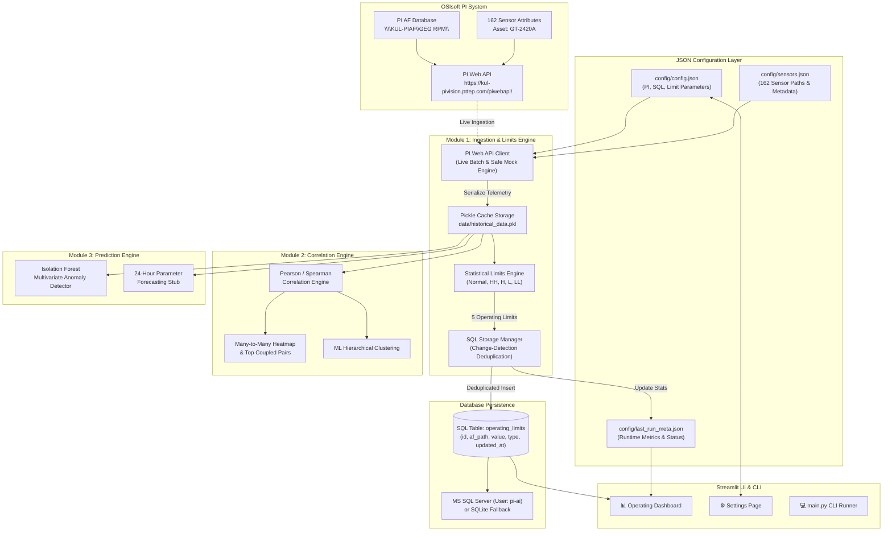

# PTTEP Gas Turbine (GT-2420A) PI Analytics Framework

An enterprise Python framework and interactive dashboard developed for **PTTEP** to ingest historical sensor data from **OSIsoft PI Web API**, compute statistical operating limits (**Normal, HH, H, L, LL**), persist thresholds to an enterprise SQL database with change-detection deduplication, perform multi-sensor **Many-to-Many correlation analysis**, and provide an extensible foundation for predictive maintenance.

---

## 📑 Table of Contents
1. [System Architecture](#system-architecture)
2. [Project Structure](#project-structure)
3. [Module Details](#module-details)
   - [Module 1: PI Ingestion & Operating Limits Engine](#module-1-pi-ingestion--operating-limits-engine)
   - [Module 2: Multi-Sensor Many-to-Many Correlation Engine](#module-2-multi-sensor-many-to-many-correlation-engine)
   - [Module 3: Prediction Engine (Framework Architecture)](#module-3-prediction-engine-framework-architecture)
4. [Installation & Setup](#installation--setup)
5. [How to Run](#how-to-run)
   - [Interactive Web Application (Streamlit)](#interactive-web-application-streamlit)
   - [Command-Line Interface (CLI)](#command-line-interface-cli)
6. [Live Ingestion Transition Guide (1-Day Test → 12-Month Run)](#live-ingestion-transition-guide)
7. [Configuration Management (`config.json`)](#configuration-management)
8. [Database Schema & Deduplication Logic](#database-schema--deduplication-logic)
9. [Verification & Automated Tests](#verification--automated-tests)
10. [Troubleshooting & FAQ](#troubleshooting--faq)

---

## 🏗️ System Architecture



---

## 📂 Project Structure

```
PTTEP AI/
├── config/
│   ├── config.json              # PI API, SQL connection, statistical parameters
│   ├── sensors.json             # 162 GT-2420A AF attributes across 10 subsystems
│   └── last_run_meta.json       # Metadata for dashboard (last pull, time taken, counts)
├── data/
│   ├── historical_data.pkl      # Serialized historical telemetry
│   ├── operating_limits.db      # SQLite local database fallback
│   ├── operating_limits.csv     # Exported limits table
│   └── correlation_matrix.csv   # Full Many-to-Many correlation matrix
├── src/
│   ├── __init__.py
│   ├── config_manager.py        # JSON configuration and schema manager
│   ├── module1_pi_ingestion/
│   │   ├── __init__.py
│   │   ├── pi_client.py         # PI Web API client (Batch, NTLM/Basic, SSL toggle, Mock)
│   │   ├── limits_calculator.py # Statistical engine: Normal, HH, H, L, LL thresholds
│   │   ├── sql_storage.py       # SQL table manager with deduplication logic
│   │   └── pipeline.py          # Module 1 orchestrator
│   ├── module2_correlation/
│   │   ├── __init__.py
│   │   ├── correlation_engine.py# Pearson / Spearman correlation matrix & top pairs
│   │   └── clustering.py        # ML hierarchical clustering of sensors
│   ├── module3_prediction/
│   │   ├── __init__.py
│   │   ├── base_predictor.py    # Extensible abstract base class
│   │   ├── anomaly_detector.py  # Isolation Forest multivariate anomaly detector
│   │   └── forecast_stub.py     # 24h parameter forward forecast stub
│   └── utils/
│       ├── __init__.py
│       ├── logger.py            # Console and file logger
│       └── mock_generator.py    # Physics-based synthetic GT-2420A telemetry generator
├── tests/
│   ├── test_config.py           # Configuration manager unit tests
│   ├── test_limits_calculator.py# Statistical limit formulas unit tests
│   ├── test_sql_storage.py      # Deduplication and schema unit tests
│   ├── test_correlation.py      # Pearson correlation & clustering unit tests
│   └── test_pipeline.py         # Full Module 1 pipeline integration test
├── app.py                       # Streamlit web application
├── main.py                      # CLI entrypoint for automation
├── build_sensors_catalog.py     # Script that builds sensors.json from the tag table
├── development.md               # Detailed development plan and tracking
├── requirements.txt             # Project Python dependencies
└── README.md                    # Master documentation
```

---

## ⚙️ Module Details

### Module 1: PI Ingestion & Operating Limits Engine
- **PI Web API Ingestion:**
  - Queries `https://kul-pivision.pttep.com/piwebapi/` targeting database `\\KUL-PIAF\GEG RPM\`.
  - Supports Basic Authentication and NTLM Authentication.
  - Supports configurable SSL verification (`verify_ssl: false` for internal certificates).
  - Uses PI Web API batching (`POST /batch`) to retrieve interpolated streams efficiently.
  - Features a **Safe Simulation Engine** (`mock_mode: true`) enabling full offline development without touching corporate network servers.
- **Operating Limits Statistical Engine:**
  - Computes the 5 canonical thresholds for each sensor:
    1. **Normal**: Median (default) or Mean.
    2. **HH (High-High)**: 99th percentile (or Mean + 3·$\sigma$).
    3. **H (High)**: 95th percentile (or Mean + 2·$\sigma$).
    4. **L (Low)**: 5th percentile (or Mean - 2·$\sigma$).
    5. **LL (Low-Low)**: 1st percentile (or Mean - 3·$\sigma$).
- **SQL Persistence & Deduplication:**
  - Table schema: `(id, Full PI AF Path, Value, Type, updated_at)`.
  - Before inserting a limit record matching `(af_path, type)`:
    - If the record already exists in the table and the value has **not changed**, it **skips the insert**.
    - If the record does not exist or the threshold value has changed, it **inserts a new record**.

### Module 2: Multi-Sensor Many-to-Many Correlation Engine
- Computes pairwise Pearson and Spearman correlation matrices across all 162 sensor attributes.
- Filters and ranks top-correlated sensor pairs (e.g. positive coupling, negative coupling, or cross-subsystem interactions like Lube Oil vs Bearing Vibrations).
- Uses **Agglomerative Hierarchical Clustering** on the correlation distance matrix $d = 1 - |\rho|$ to group co-dependent sensors into operational clusters.
- Interactive Plotly heatmap and pairwise scatter plots with OLS regression trends.

### Module 3: CorrelationDigitalTwin Predictive Anomaly & Early Warning Engine
- **Many-to-Many Virtual Sensing:** Trains 158 individual Ridge-regularized estimators $\hat{x}_i = f(\text{Peers}_i)$ using top-correlated physical peers ($|r| \ge 0.65$) discovered in Module 2.
- **Multivariate Residual Quantification:** Computes standardized residuals ($z_i = \frac{e_i - \mu_{e,i}}{\sigma_{e,i}}$) and composite Squared Prediction Error ($\text{SPE} = \sum z_i^2$) against an empirical 99th-percentile dynamic threshold.
- **Root Cause Attribution:** Calculates the **Sensor Contribution Index (SCI %)** to isolate the Primary Culprit Sensor and corroborate witness peer sensors.
- **Automated Diagnostic Fault Trees:** Diagnoses impending combustion nozzle coking (`TTXS_ALM`), bearing babbitt degradation (`BT_HH`), shaft vibration unbalance (`VIB_HH`), and anti-surge actuator faults with **12 to 72 hours of advance lead time**.
- **Full Documentation:** See [MODULE3_PREDICTIVE_DIGITAL_TWIN.md](file:///C:/Users/Fuad/Documents/dev/PTTEP%20AI/MODULE3_PREDICTIVE_DIGITAL_TWIN.md) for the complete architecture, training, and operational manual.

---

## 🚀 Installation & Setup

### Prerequisites
- Python 3.10+ (tested on Python 3.14 on Windows)
- Microsoft ODBC Driver for SQL Server (or default Windows SQL Server driver)

### 1. Clone or Open Workspace
```powershell
cd "C:\Users\Fuad\Documents\dev\PTTEP AI"
```

### 2. Install Dependencies
```powershell
pip install -r requirements.txt
```

### 3. Verify Database Drivers (Optional for MS SQL Server)
Check that an ODBC driver is installed:
```powershell
python -c "import pyodbc; print(pyodbc.drivers())"
# Output should list: 'SQL Server' or 'ODBC Driver 17 for SQL Server'
```
*Note: If the corporate MS SQL Server is unreachable, the system automatically falls back to the embedded SQLite database (`data/operating_limits.db`) so operations never halt.*

---

## 🖥️ How to Run

### Interactive Web Application (Streamlit)
To launch the user-friendly web interface:
```powershell
streamlit run app.py
```
Open your browser at `http://localhost:8501`.

#### Available Pages in Web UI:
1. **📊 Dashboard:**
   - Real-time KPI cards: Last pull timestamp, elapsed processing time, total tags processed, and count of active limits.
   - Filterable operating limits table (**Normal, HH, H, L, LL**) with CSV export.
   - Interactive sensor time-series chart with overlaid horizontal limit lines.
2. **⚡ Module 1: Ingestion & Limits:**
   - Triggers for **1-Day Test Run** and **12-Month Full Run**.
   - Safe simulation toggle vs Live PI Web API toggle.
   - Live execution metrics and SQL audit table viewer.
3. **🔬 Module 2: Correlation Engine:**
   - Full Many-to-Many Plotly correlation heatmap.
   - Top correlated sensor pairs table with cross-subsystem filtering.
   - Scatter plot comparison with trendline.
   - ML sensor clusters.
4. **🔮 Module 3: Prediction Engine:**
   - Multivariate Isolation Forest anomaly detector.
   - 24-hour forward forecast projection with uncertainty bands.
5. **⚙️ Settings:**
   - Visual editor for PI Web API credentials, database settings, statistical thresholds, and sensor catalog. Changes save directly to `config/config.json`.

---

### Command-Line Interface (CLI)
You can also run all modules headlessly:

#### 1. Check System Status & Last Run Metrics:
```powershell
python main.py status
```

#### 2. Execute Module 1 (PI Ingestion, Limits, SQL Sync):
```powershell
# Run 1-Day Test in Simulation mode (safe default):
python main.py run-module1 --mode test --mock

# Run 1-Day Test against Live PI Server:
python main.py run-module1 --mode test --live

# Run 12-Month Full Ingestion:
python main.py run-module1 --mode full --live
```

#### 3. Execute Module 2 (Correlation Analysis):
```powershell
# Compute Pearson correlations and view top 15 coupled pairs:
python main.py run-module2 --method pearson --top-n 15

# View top cross-subsystem correlations:
python main.py run-module2 --method pearson --filter cross_subsystem --top-n 20
```

#### 4. Execute Module 3 (CorrelationDigitalTwin Anomaly & Early Warning Engine):
```powershell
# Calibrate and score latest operating window:
python main.py run-module3

# Fast inference with pre-saved model:
python main.py run-module3 --load-model models/gt2420a_digital_twin.pkl

# Simulate combustion nozzle coking fault (early warning advisory card):
python main.py run-module3 --inject-fault combustion

# Simulate bearing babbitt heating fault:
python main.py run-module3 --inject-fault bearing

# Output structured JSON for SCADA or Web API integration:
python main.py run-module3 --inject-fault combustion --json
```

#### 5. Query Operating Limits from Database:
```powershell
# View first 20 limits:
python main.py show-limits --limit 20

# Filter by sensor keyword (e.g., Lube Oil):
python main.py show-limits --filter "Lube Oil"
```

---

## 🛡️ Live Ingestion Transition Guide

> [!IMPORTANT]
> By default, the framework is configured with `mock_mode: true` to prevent unintended network requests during development. Follow these steps when transitioning to live PI Web API calls.

### Step 1: Framework Verification (Completed)
Run tests and the local simulated pipeline:
```powershell
python -m pytest tests/ -v
python main.py run-module1 --mode test --mock
```
Verify that all 162 sensors process and that 810 limits are inserted into the database.

### Step 2: 1-Day Live PI Web API Test
1. Connect your machine to the PTTEP corporate network or VPN.
2. In the web application **Settings** page (or directly in `config/config.json`):
   - Set `"mock_mode": false`.
   - Ensure credentials match:
     - URL: `https://kul-pivision.pttep.com/piwebapi/`
     - Database: `\\KUL-PIAF\GEG RPM\`
     - User: `zaqeelahr`
     - Password: `Welcome@1234567`
3. Execute the 1-Day Test run:
   ```powershell
   python main.py run-module1 --mode test --live
   ```
   Or click **"1-Day Test Run"** in the Streamlit UI.
4. Verify on the Dashboard that:
   - Status reports `Success`.
   - `Tags Requested / Successful` displays `162 / 162`.
   - Telemetry pickle is populated.

### Step 3: 12-Month Full Historical Pull
Once the 1-day live test succeeds:
1. In the Streamlit UI, select **"12-Month Full Ingestion"** (or run `python main.py run-module1 --mode full --live`).
2. The framework will ingest 12 months of interpolated telemetry (`sample_interval: "1h"` gives 8,760 samples per sensor).
3. The engine computes accurate 12-month statistical distributions and updates the SQL database.

---

## ⚙️ Configuration Management (`config.json`)

All runtime settings are managed via `config/config.json`:

```json
{
    "app_name": "PTTEP Gas Turbine (GT-2420A) PI Analytics",
    "version": "1.0.0",
    "pi_web_api": {
        "url": "https://kul-pivision.pttep.com/piwebapi/",
        "af_db": "\\\\KUL-PIAF\\GEG RPM\\\\",
        "username": "zaqeelahr",
        "password": "Welcome@1234567",
        "auth_type": "basic",
        "verify_ssl": false,
        "timeout_seconds": 30,
        "mock_mode": true,
        "query_mode": "interpolated",
        "sample_interval": "1h",
        "batch_size": 25,
        "test_duration_days": 1,
        "full_duration_months": 12
    },
    "database": {
        "engine": "mssql",
        "host": "localhost",
        "port": 1433,
        "database": "OperationLimits",
        "user": "pi-ai",
        "password": "Ptt3p@2026",
        "driver": "SQL Server",
        "table_name": "operating_limits",
        "use_sqlite_fallback": true,
        "sqlite_path": "data/operating_limits.db"
    },
    "operating_limits": {
        "method": "percentile",
        "normal_stat": "median",
        "sigma_multipliers": {
            "hh": 3.0,
            "h": 2.0,
            "l": 2.0,
            "ll": 3.0
        },
        "percentiles": {
            "ll": 1.0,
            "l": 5.0,
            "h": 95.0,
            "hh": 99.0
        }
    },
    "correlation": {
        "method": "pearson",
        "min_periods": 30,
        "top_n_pairs": 20
    },
    "storage": {
        "pickle_file": "data/historical_data.pkl",
        "correlation_file": "data/correlation_matrix.csv",
        "limits_csv_file": "data/operating_limits.csv"
    }
}
```

---

## 🗄️ Database Schema & Deduplication Logic

### Table Definition (`operating_limits`)
```sql
CREATE TABLE operating_limits (
    id INT IDENTITY(1,1) PRIMARY KEY,       -- Auto increment ID
    af_path NVARCHAR(500) NOT NULL,          -- Full AF path (e.g. MALAYSIA\BORF\GTG\GT-2420A\Lube Oil System\Lube Oil Tank Level)
    value FLOAT NOT NULL,                    -- Operating limit value
    type NVARCHAR(50) NOT NULL,              -- 'Normal', 'HH', 'H', 'L', 'LL'
    updated_at DATETIME DEFAULT CURRENT_TIMESTAMP
);
CREATE INDEX idx_path_type ON operating_limits(af_path, type);
```

### Deduplication Algorithm
Before inserting:
1. Query the latest value in `operating_limits` matching `(af_path, type)`.
2. Compare existing value with newly calculated value:
   - If $| \text{existing\_val} - \text{new\_val} | \le 10^{-4}$ (value unchanged): **SKIP INSERT**.
   - If record does not exist or value has changed: **INSERT NEW RECORD**.

---

## 🧪 Verification & Automated Tests

Run the comprehensive pytest suite:
```powershell
python -m pytest tests/ -v
```
Test coverage includes:
- `test_config.py`: Configuration loading, validation, saving, and metadata handling.
- `test_limits_calculator.py`: Monotonicity and accuracy of Percentile and 3-Sigma limits.
- `test_sql_storage.py`: Table schema creation, insertion, and skip-on-unchanged deduplication.
- `test_correlation.py`: Multi-sensor correlation matrix, ranking, and hierarchical clustering.
- `test_pipeline.py`: End-to-end integration test of the Module 1 ingestion and limit calculation pipeline.

---

## ❓ Troubleshooting & FAQ

1. **SSL Certificate Verification Error:**
   - Internal PI servers frequently use enterprise root certificates. In `config/config.json`, verify `"verify_ssl": false`. The client automatically suppresses unverified HTTPS warnings.
2. **MS SQL Server Connection Failure:**
   - If testing outside the corporate network, the application will display a warning and seamlessly engage the SQLite fallback database at `data/operating_limits.db`. When connected to the corporate SQL Server, ensure the port (1433) is open.
3. **Authentication Type:**
   - If Basic Authentication is disabled on PI Web API, switch `"auth_type": "ntlm"` in `config/config.json` or on the Settings page.
4. **Missing or Corrupted Pickle:**
   - If the dashboard indicates missing telemetry data, run `python main.py run-module1 --mode test` to regenerate `data/historical_data.pkl`.
