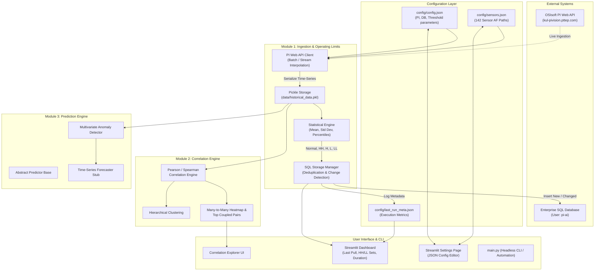

# Development Plan: PTTEP Gas Turbine (GT-2420A) PI Analytics Framework

## 1. Project Overview & Objectives
This application is designed for PTTEP's Gas Turbine Generator unit `GT-2420A` (located under `MALAYSIA\BORF\GTG\GT-2420A` in OSIsoft PI AF). The solution provides an end-to-end framework consisting of:
1. **Module 1: PI Web API Ingestion & Statistical Operating Limit Engine**
   - Ingest 142 GT-2420A sensor tags across 10 critical subsystems from PI Web API.
   - Store historical raw/interpolated time-series data locally in serialized pickle format for fast analysis.
   - Compute statistical operating thresholds: **Normal**, **High-High (HH)**, **High (H)**, **Low (L)**, and **Low-Low (LL)** using parametric (Mean ± k·Std) and non-parametric (Percentile) methodologies.
   - Persist operating thresholds to an enterprise SQL database table `(id, Full PI AF Path, Value, Type)` with change-detection deduplication.
2. **Module 2: Multi-Sensor Many-to-Many Correlation Engine**
   - Compute cross-sensor Pearson and Spearman correlation matrices across all 142 attributes.
   - Identify high-coupling relationships across subsystems (e.g. Lube Oil temperature vs Bearing vibration).
   - Perform hierarchical clustering to group sensors into operational co-movement clusters.
3. **Module 3: Predictive & Health Monitoring Engine (Extensible Architecture)**
   - Future-ready framework for multivariate sensor anomaly detection and time-series forecasting.
   - Baseline statistical anomaly detection and Isolation Forest baseline.
4. **Web UI Dashboard & Configuration Management**
   - Streamlit web interface with Dashboard, Ingestion controls, Correlation explorer, and Settings page.
   - Centralized JSON-based configuration management.

---

## 2. Architecture & Data Flow

---

## 3. Step-by-Step Implementation Roadmap

### Phase 1: Environment & Directory Scaffolding (Completed)
- [x] Inspect Python runtime (Python 3.14.3) and Windows platform drivers.
- [x] Verify availability of ODBC drivers (`SQL Server`).
- [x] Install runtime requirements (`streamlit`, `scikit-learn`, `scipy`, `plotly`).
- [x] Validate all library imports.

### Phase 2: Configuration & Sensor Catalog Definition
- [ ] Create `config/sensors.json` containing all 142 attributes across the 10 subsystems of `MALAYSIA\BORF\GTG\GT-2420A`.
- [ ] Create `config/config.json` defining PI Web API connection details, SQL server parameters, calculation methodologies (3-sigma vs percentiles), and operational folders.
- [ ] Create `config/last_run_meta.json` with initial placeholder telemetry.
- [ ] Implement `src/config_manager.py` with schema validation and atomic file writes.

### Phase 3: Module 1 Implementation
- [ ] Implement `src/utils/mock_generator.py`: High-fidelity synthetic operational data generator matching physical ranges of GT-2420A sensors (temperatures, vibrations, pressures, flows, levels) for offline validation without touching the live PI server during initial development.
- [ ] Implement `src/module1_pi_ingestion/pi_client.py`:
  - Support Basic & NTLM authentication.
  - Configurable SSL verification (`verify=False` support).
  - Batching mechanism for PI Web API attribute lookups and stream interpolated data fetching.
  - Safe mode toggle: live vs simulation mode.
  - Support 1-day test pull vs 12-month full pull.
- [ ] Implement `src/module1_pi_ingestion/limits_calculator.py`:
  - Calculate `Normal` (median or mean), `HH` (Mean + 3σ or P99), `H` (Mean + 2σ or P95), `L` (Mean - 2σ or P5), `LL` (Mean - 3σ or P1).
  - Handles missing data, outliers, zero-variance signals safely.
- [ ] Implement `src/module1_pi_ingestion/sql_storage.py`:
  - Database schema: `(id, Full PI AF Path, Value, Type, updated_at)`.
  - SQLAlchemy engine supporting Microsoft SQL Server (`pyodbc`) and SQLite local fallback.
  - Deduplication logic: query current `(af_path, type)`. If exists and value matches, skip insert; otherwise insert new record.
- [ ] Implement `src/module1_pi_ingestion/pipeline.py`:
  - Orchestrates pull -> pickle dump -> limits calculation -> SQL persistence -> metadata recording.

### Phase 4: Module 2 Implementation (Correlation Engine)
- [ ] Implement `src/module2_correlation/correlation_engine.py`:
  - Pairwise Pearson correlation computation across all 142 sensors.
  - Many-to-Many cross-subsystem correlation ranking (e.g. top positive & negative correlated sensor pairs).
  - Handling of non-stationary / time-aligned pandas series.
- [ ] Implement `src/module2_correlation/clustering.py`:
  - Hierarchical linkage and sensor cluster discovery.

### Phase 5: Module 3 Implementation (Prediction Engine Stub)
- [ ] Implement `src/module3_prediction/base_predictor.py`: Extensible interface for future model plug-ins.
- [ ] Implement `src/module3_prediction/anomaly_detector.py`: Baseline statistical and Isolation Forest anomaly score provider.
- [ ] Implement `src/module3_prediction/forecast_stub.py`: Ready architecture for forecasting sensor trends.

### Phase 6: Interactive Web Application (Streamlit)
- [ ] Build multi-tab Streamlit dashboard:
  - **Overview / Dashboard**: Last data pull timestamp, elapsed processing time, total tags processed, HH/LL summary metrics, filterable table of active limits.
  - **Data Ingestion & Limit Setting**: Manual triggers for "1-Day Test Run (Simulation/Live)" and "12-Month Full Ingestion", live status indicators, limit distribution graphs.
  - **Sensor Correlation Explorer**: Interactive Plotly heatmap, subsystem filter (e.g. Compressor vs Gas Turbine), top correlation rankings table, scatter plot comparisons.
  - **Prediction Engine (Preview)**: Overview of future module architecture and baseline anomaly detector testing.
  - **Settings Page**: Full interactive configuration editor for PI Web API credentials, database settings, statistical parameters, and sensor tag catalog manager.

### Phase 7: Verification & Testing
- [ ] Unit tests for configuration management, limits calculator, SQL storage deduplication, and correlation engine.
- [ ] End-to-end dry-run verification using simulated 1-day and 12-month data (preserving rule: NO LIVE PI NETWORK CALLS during framework development).
- [ ] Verify SQL deduplication (matching records skipped, changed records inserted).

### Phase 8: Comprehensive Documentation
- [ ] Deliver complete `README.md` covering architecture, installation, database setup, step-by-step 1-day testing procedure, 12-month transition instructions, and troubleshooting.
