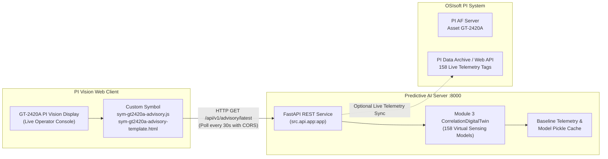

# OSIsoft PI Vision Custom Symbol Integration: GT-2420A Predictive Advisory

**Component:** PI Vision Custom Extensibility Symbol + FastAPI Backend  
**Asset:** Gas Turbine `GT-2420A` (158 Sensors)  
**Target Platform:** OSIsoft PI Vision 2020 / 2022+  
**Date:** October 2026  

---

## 1. System Architecture Overview



---

## 2. Telemetry Datapoint Sizing: How Many Datapoints Are Needed?

When connecting PI Vision or streaming data into the Predictive Engine:

### A. Mathematical Minimum: 1 Concurrent Data Point per Sensor
* **Why 1 Point Works:**  
  The Digital Twin estimator operates on concurrent multivariate state:
  $$\hat{x}_i = \sum_{j \in \text{Peers}(x_i)} w_{i,j} x_j + b_i$$
  Because each sensor is reconstructed using simultaneous readings from its physical peer cluster at timestamp $t$, **exactly 1 synchronized reading per sensor** is mathematically sufficient to compute the expected values, residuals ($e_i = x_i - \hat{x}_i$), z-scores ($z_i$), composite Squared Prediction Error ($\text{SPE}$), and Sensor Contribution Index ($\text{SCI}$).

### B. Recommended Operational Best Practice: 12 to 24 Datapoints per Sensor
* **Recommended Window:** **12 to 24 points** per sensor (e.g., the last **1 to 2 hours of data sampled at 5-minute intervals**, or the last **24 hours of hourly data**).
* **Engineering Advantages:**
  1. **Transient Noise & Spike Suppression:** Industrial sensors occasionally experience brief single-second electrical spikes or communication dropouts. Receiving 12–24 points allows the engine to enforce **streak persistence** (`min_consecutive_anomalies = 2`), ensuring alarms only trigger if the deviation persists for $\ge 2$ consecutive timestamps.
  2. **Automated Missing Value Imputation (`ffill`):** If a single PI point momentarily drops a scan, the window enables seamless forward-filling without throwing NaN errors.
  3. **Trend & Degradation Velocity:** Enables calculating degradation velocity ($\frac{de}{dt}$) to estimate realistic lead time before physical trip limits are reached.
  4. **Sparkline Visualization:** The custom symbol can plot a mini 2-hour trendline of the health score directly on the PI Vision card.

---

## 3. Step-by-Step Deployment Guide

### Step 1: Launch the FastAPI Service on the AI Server
On the machine hosting the analytics pipeline (or local server):

```powershell
# Activate Python environment
cd "C:\Users\Fuad\Documents\dev\PTTEP AI"

# Launch the FastAPI REST service on port 8000
python main.py serve-api --host 0.0.0.0 --port 8000
```

Verify in your browser:
* **Interactive Swagger Documentation:** `http://localhost:8000/docs`
* **API Health Check:** `http://localhost:8000/api/v1/health`
* **Latest Advisory Card Payload:** `http://localhost:8000/api/v1/advisory/latest`
* **Pre-rendered HTML Card:** `http://localhost:8000/api/v1/card-html?simulate=combustion`

---

### Step 2: Deploy Custom Symbol to PI Vision Server

1. Log into your **OSIsoft PI Vision Server** (with administrative rights).
2. Locate the PI Vision custom extensibility directory:
   ```
   C:\Program Files\PIPC\PIVision\Scripts\app\editor\symbols\ext\
   ```
   *(Or `%PIHOME64%\PIVision\Scripts\app\editor\symbols\ext\`)*

3. Copy the following two files into the `ext` folder:
   - `pi_vision/sym-gt2420a-advisory.js`
   - `pi_vision/sym-gt2420a-advisory-template.html`

4. (Optional) Copy an icon for the PI Vision toolbar:
   - Place a $32 \times 32$ PNG icon named `sym-gt2420a-advisory.png` inside:
     `C:\Program Files\PIPC\PIVision\Scripts\app\editor\symbols\ext\Icons\`

5. Restart the Microsoft IIS Web Server to load the new symbol:
   ```cmd
   iisreset
   ```

---

### Step 3: Add the Symbol to a PI Vision Display

1. Open your browser and navigate to PI Vision: `https://<pivision-server>/PIVision`.
2. Open or create the **GT-2420A Monitoring Display**.
3. In the left-hand symbol menu, click on the new **"GT-2420A Predictive Advisory"** icon.
4. Click anywhere on the display canvas to place the card.
5. Right-click the placed card and select **"Format Symbol"**:
   - **API URL:** Set to `http://<ai-server-ip>:8000/api/v1/advisory/latest`
   - **Refresh Interval (Seconds):** Set to `30`
   - **Lookback Points:** Set to `24`
   - **Simulate Fault:** Set to `none` (or select `combustion` / `bearing` to preview live alarm response)
6. Save the PI Vision display.

---

## 4. API Endpoint Reference for PI Vision Custom Integration

| Method | Endpoint | Description |
|---|---|---|
| `GET` | `/api/v1/health` | Service and model health status (`HEALTHY`, modeled sensor count). |
| `GET` | `/api/v1/advisory/latest` | Returns the latest Early Warning Advisory JSON (polled by PI Vision symbol). Supports `?lookback=24&simulate_fault=combustion`. |
| `POST` | `/api/v1/diagnose` | Accepts a custom JSON payload (1-point snapshot or 24-point time series) and returns the full diagnostic advisory. |
| `POST` | `/api/v1/simulate` | Test endpoint to simulate combustion nozzle coking or bearing heating. |
| `GET` | `/api/v1/sensors` | Returns catalog of all 158 modeled tags, subsystems, and peer clusters. |
| `GET` | `/api/v1/card-html` | Returns pre-rendered standalone HTML card component (usable in iframes). |
