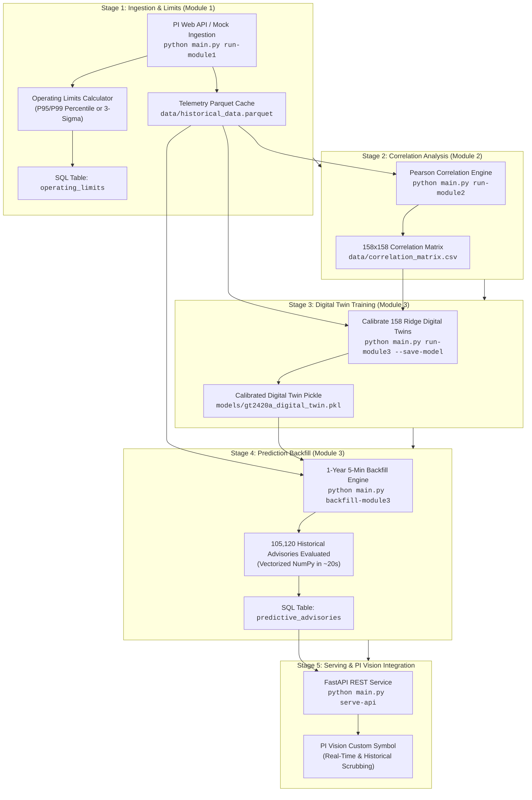

# Commissioning & Initial Setup Guide with Prefilled Historical Data
## PTTEP Gas Turbine GT-2420A Predictive Anomaly & Early Warning System

This guide outlines the complete end-to-end installation, commissioning, and historical backfill procedure for the **PTTEP GT-2420A PI Analytics & Early Warning Platform**. 

It details the exact chronological execution order, explains when **limits setup**, **correlation analysis**, **model training**, and **prediction backfill** take place, and defines the recurring retraining lifecycle.

---

## 1. End-to-End Commissioning Workflow

The system is designed with a strict sequential dependency pipeline. Telemetry must be ingested before correlation can be computed; correlation must be computed before the digital twin can select peer sensors; and the digital twin must be trained before historical predictions can be backfilled.



---

## 2. Chronological Setup Execution Guide

### Step 1: Telemetry Data Ingestion (Module 1)
Pulls time-series telemetry from PI Web API (or mock generator) for all 158 tags across the 6 turbine subsystems and stores them in Apache Parquet.

#### Scenario A: Ingest Historical Baseline from 2 Years Ago to 1 Year Ago (`-2y` to `-1y`)
Use this when you want an older, pristine operating year as a reference baseline (e.g. before major maintenance):
```powershell
# Ingest 1-year baseline (2024 to 2025) at 5-minute intervals
python main.py run-module1 --start "2024-10-14 00:00" --end "2025-10-14 00:00" --interval 5m --live
```

#### Scenario B: Ingest Telemetry from 1 Year Ago to Now (`-1y` to `Now`)
Pulls the past 12 months up to the current date/time:
```powershell
# Default 12-month full mode (auto-calculates Start = Now - 12 months)
python main.py run-module1 --mode full --interval 5m --live
```

> [!NOTE]
> * **Automatic Concatenation (Resume):** By default, `run-module1` inspects existing parquet files. If you run Scenario A and then Scenario B, both time ranges are merged, chronologically sorted, and deduplicated automatically.
> * **Clean Overwrite:** To start completely fresh without merging existing data, append `--no-resume`.
> * **Offline Commissioning:** Replace `--live` with `--mock` to simulate telemetry if PI VPN is unavailable.

---

### Step 2: Operating Limits Setup (When & How it Runs)

#### When is it executed?
Operating Limits calculation is **automatically executed at the end of Step 1 (`run-module1`)**. 
1. `pipeline.py` computes statistical limits (Normal Median, High `H`, High-High `HH`, Low `L`, Low-Low `LL`) across all 158 sensors.
2. The limits are immediately written to [`data/operating_limits.csv`](file:///C:/Users/Fuad/Documents/dev/PTTEP%20AI/data/operating_limits.csv) and synchronized into the SQL `operating_limits` table with duplicate suppression.

#### Standalone Execution / Recalculation:
If you want to recompute limits using a specific time window or method (e.g., only using the baseline year, or switching from `percentile` to `sigma`):
```powershell
# Compute limits on the baseline year using 3-sigma method:
python main.py calc-limits --start "2024-10-14 00:00" --end "2025-10-14 00:00" --method sigma

# Inspect active limits in SQL:
python main.py show-limits --filter "TT-08"
```

---

### Step 3: Correlation Matrix Analysis (Module 2)

#### When is it executed?
Executed **immediately after telemetry is ingested (Step 1)**. Module 3 requires this matrix to identify which sensors physically and thermodynamically interact with one another.

#### Execution Command:
```powershell
python main.py run-module2 --method pearson --top-n 30
```

#### What happens:
1. Reads [`data/historical_data.parquet`](file:///C:/Users/Fuad/Documents/dev/PTTEP%20AI/data/historical_data.parquet).
2. Computes the full $158 \times 158$ Pearson correlation matrix.
3. Automatically saves the matrix to [`data/correlation_matrix.csv`](file:///C:/Users/Fuad/Documents/dev/PTTEP%20AI/data/correlation_matrix.csv).
4. Prints top correlated sensor pairs and cross-subsystem interactions for operator verification.

---

### Step 4: Digital Twin Model Training & Calibration (Module 3)

#### When is it executed?
Executed **after the correlation matrix is generated (Step 3)** and **before running the historical backfill or launching the API**.

#### Execution Command:
```powershell
python main.py run-module3 --save-model models/gt2420a_digital_twin.pkl
```

#### What happens:
1. Loads [`data/correlation_matrix.csv`](file:///C:/Users/Fuad/Documents/dev/PTTEP%20AI/data/correlation_matrix.csv) and identifies the **Top 5 peer sensors** ($|r| \ge 0.65$) for each of the 158 sensors.
2. Fits 158 individual Ridge regression estimators ($y_i = \mathbf{w}_i^T \mathbf{x}_{\text{peers}} + b_i$).
3. Establishes baseline residual normal distributions ($\mu_i, \sigma_i$) across normal operating telemetry.
4. Computes the plant-wide composite squared prediction error (SPE) anomaly threshold ($\tau_{\text{system}} = 732.01$).
5. Serializes the trained digital twin into [`models/gt2420a_digital_twin.pkl`](file:///C:/Users/Fuad/Documents/dev/PTTEP%20AI/models/gt2420a_digital_twin.pkl).

---

### Step 5: Historical Prediction Backfill for Past 1 Year (5-Min Interval)

#### When is it executed?
Executed **during initial commissioning** so the SQL database is pre-populated with 1 full year of historical advisory records. This allows engineers to immediately scrub the PI Vision time bar across the past year and see digital twin advisory cards.

#### Execution Command:
```powershell
python main.py backfill-module3 --days 365 --interval 5m --batch-size 5000
```

#### What happens:
1. Resamples the past 365 days of telemetry into **105,120 discrete 5-minute timestamps**.
2. Evaluates all 158 digital twins using vectorized matrix operations in **~20 seconds**.
3. Diagnoses anomaly states, calculates Sensor Contribution Index (SCI%), identifies culprit tags, and infers root-cause fault tree recommendations.
4. Bulk-inserts all 105,120 records into the SQL table `predictive_advisories` in batches of 5,000 in **~1 to 2 minutes**.

---

### Step 6: Launch Real-Time API Service

Once the historical backfill is complete, launch the FastAPI integration service:
```powershell
python main.py serve-api --host 0.0.0.0 --port 8000
```

* **Interactive API Docs:** `http://localhost:8000/docs`
* **PI Vision Advisory Endpoint:** `http://localhost:8000/api/v1/advisory/latest`
* **Historical Time-Scrubbing:** `http://localhost:8000/api/v1/advisory/latest?timestamp=2026-07-15T14:00:00Z` (instant `<10ms` cache hit from SQL `predictive_advisories`).

---

## 3. Lifecycle, Execution Timing & Retraining Matrix

The table below answers: **When does each step execute, what triggers it, and when should it be retrained in production?**

| Component | Initial Setup Timing | Trigger Condition | Input Dependencies | Output Artifacts | Retraining Frequency in Production |
| :--- | :--- | :--- | :--- | :--- | :--- |
| **Telemetry Ingestion** (Module 1) | **Step 1** (Day 0) | Manual CLI / Commissioning Script | PI Web API credentials or mock mode | `data/historical_data.parquet` | **Continuous / Scheduled:** Runs every 5 mins via ingestion worker or cron to ingest new telemetry. |
| **Operating Limits Setup** | **Step 2** (Runs automatically during Step 1) | Auto-invoked by `pipeline.py` after telemetry ingestion | `data/historical_data.parquet` | SQL table `operating_limits`, `data/operating_limits.csv` | **Quarterly / Post-Overhaul:** Recalculate whenever major equipment maintenance or baseline operating regime changes (`python main.py calc-limits`). |
| **Correlation Analysis** (Module 2) | **Step 3** (Right after Step 1) | Manual CLI command | `data/historical_data.parquet` | `data/correlation_matrix.csv` | **Semi-Annually / Post-Turnaround:** Recalculate if new instrumentation is installed or physical piping/valves are modified (`python main.py run-module2`). |
| **Digital Twin Training** (Module 3) | **Step 4** (Right after Step 3) | Manual CLI command | `data/historical_data.parquet`, `data/correlation_matrix.csv` | `models/gt2420a_digital_twin.pkl` | **Bi-Annually / Major Overhaul:** Retrain model after major turbine overhaul when component baseline efficiencies change (`python main.py run-module3 --save-model`). |
| **Prediction Backfill** (Module 3) | **Step 5** (After model training) | Commissioning setup command | `data/historical_data.parquet`, `models/gt2420a_digital_twin.pkl` | SQL table `predictive_advisories` | **One-time during Commissioning:** Only run for past historical periods. New incoming real-time points are evaluated live via API or ingestion worker. |
| **FastAPI REST Service** | **Step 6** (Final step) | System startup / Windows Service | SQL Database & Digital Twin Model | REST Endpoints on Port 8000 | **Daemon:** Runs continuously 24/7 as a service. |

---

## 4. SQL Verification Queries

To confirm that the database is fully primed and ready for PI Vision, run the following SQL queries:

### Check Operating Limits in SQL:
```sql
SELECT 
    subsystem, 
    COUNT(*) as tag_count, 
    MIN(limit_h) as min_warning, 
    MAX(limit_hh) as max_alarm
FROM operating_limits
GROUP BY subsystem;
```

### Check Historical Predictive Advisories in SQL:
```sql
SELECT 
    COUNT(*) AS total_advisories,
    MIN(timestamp) AS earliest_advisory,
    MAX(timestamp) AS latest_advisory,
    SUM(CASE WHEN is_anomaly = 1 THEN 1 ELSE 0 END) AS anomaly_count
FROM predictive_advisories;
```

### Inspect the Top 10 Earliest Historical Anomalies:
```sql
SELECT TOP 10 
    timestamp, 
    health_score, 
    severity, 
    predicted_incident, 
    culprit_sensor, 
    culprit_sci_pct, 
    lead_time_hours, 
    root_cause_diagnosis
FROM predictive_advisories
WHERE is_anomaly = 1
ORDER BY anomaly_score DESC;
```
